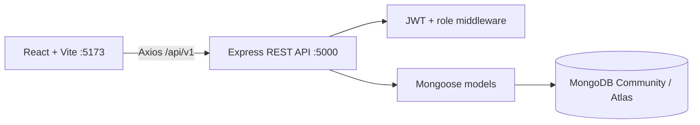

# LabOps — Smart Laboratory Management & Asset Tracking

LabOps centralizes laboratory equipment, reservations, fault reports, maintenance workflows, and operational analytics for an educational institution. Students can browse and request equipment; technicians handle assigned lab maintenance; administrators manage operations and users.

## Problem and objectives

Equipment records, repair requests, and room bookings often live in separate spreadsheets and informal messages. LabOps provides one authenticated workspace with traceable assets, reservation conflict checks, role-specific access, and MongoDB-backed reporting.

## Technology

React 18, JavaScript, Vite, React Router, Axios, Lucide React, Recharts, CSS; Node.js, Express, JavaScript ES modules, Mongoose, Zod; MongoDB Community Server locally or MongoDB Atlas in production; JWT and bcryptjs authentication.

## Features

- Student registration and login, asset browsing, QR-resolvable asset records, reservation requests, maintenance reports, personal history, and notifications.
- Technician assignment-scoped inventory and maintenance access.
- Administrator asset and lab management, user accounts, reservation decisions, analytics, and activity feed.
- Database-backed dashboard aggregates, search and filters, pagination-ready asset API, status badges, form validation, responsive dark interface, and loading/error states.
- JWT-protected API, role authorization, password hashing, authentication rate limits, Helmet, CORS configuration, and persisted notifications.

## Role permissions

| Capability                        | Student |    Technician | Administrator |
| --------------------------------- | ------: | ------------: | ------------: |
| Browse inventory and view details |     Yes | Assigned labs |           Yes |
| Request/cancel own reservation    |     Yes |             — |           Yes |
| Approve/reject reservations       |       — |             — |           Yes |
| Report faults                     |     Yes |           Yes |           Yes |
| Process maintenance               |       — | Assigned labs |           Yes |
| Manage laboratories and staff     |       — |             — |           Yes |
| View analytics and activity       |       — |             — |           Yes |

## Architecture



## Folder structure

```text
client/       React app, shared API client, auth context, responsive views
server/       Express entry point, models, routes, middleware, seed, tests
docs/         Setup, database, API, and testing guides
screenshots/  Project screenshots (add captures here)
```

## Setup: Windows local development

1. Install Node.js 20 or newer and MongoDB Community Server. Compass is a separate GUI client and does not start the database server.
2. Start the MongoDB Windows service. The default URI is `mongodb://127.0.0.1:27017/labops`.
3. Copy `server/.env.example` to `server/.env`; set a long private `JWT_SECRET`. Keep `.env` files out of Git.
4. From the project root, run `npm run install:all`.
5. Seed the local database with `npm run seed` (or `npm run seed --prefix server`).
6. Run `npm run dev`. Visit `http://localhost:5173`; Express listens on port 5000 and Vite proxies `/api` requests.
7. In Compass, connect to `mongodb://127.0.0.1:27017`, then inspect the `labops` database and its collections.

Detailed steps: [docs/SETUP.md](docs/SETUP.md). The API health endpoint is `GET /api/v1/health`; it reports database state after the server connects. A Compass welcome screen with no deployment listed means no connection is saved yet. Use the URI above after starting Community Server.

## Demo accounts

The idempotent seed script creates the accounts below. Development password for all seeded demo users: `LabOpsDemo2026!`. Change this password and remove seed demo users before production deployment.

| Role       | Email                    |
| ---------- | ------------------------ |
| Admin      | `admin@labops.demo`      |
| Technician | `technician@labops.demo` |
| Student    | `student@labops.demo`    |

The seed creates 3 labs, 20 assets, 6 demo users, 5 maintenance tickets, and 5 reservations without duplicating them when rerun.

## API overview

All endpoints are prefixed `/api/v1`. Sign-in and public student registration are under `/auth`; other endpoints require `Authorization: Bearer <token>`.

| Area          | Routes                                                                                               |
| ------------- | ---------------------------------------------------------------------------------------------------- |
| Auth          | `POST /auth/register`, `POST /auth/login`, `GET /auth/me`, `POST /auth/logout`                       |
| Laboratories  | `GET/POST /labs`, `PATCH/DELETE /labs/:id`                                                           |
| Assets        | `GET/POST /assets`, `GET/PATCH/DELETE /assets/:id`, `GET /assets/:id/qr`, `GET /assets/qr/:qrCodeId` |
| Reservations  | `GET/POST /reservations`, `PATCH /reservations/:id/status`, `PATCH /reservations/:id/cancel`         |
| Maintenance   | `GET/POST /maintenance`, `GET/PATCH /maintenance/:id`                                                |
| Notifications | `GET /notifications`, `PATCH /notifications/:id/read`                                                |
| Users         | `GET/POST /users`, `PATCH /users/:id` (admin only)                                                   |
| Analytics     | `GET /analytics/overview`, `/assets`, `/maintenance`, `/reservations` (admin only)                   |

Full endpoint details and response examples: [docs/API.md](docs/API.md).

## Database collections

`users`, `laboratories`, `assets`, `reservations`, `maintenances`, `notifications`, and `activitylogs`. Mongoose models use ObjectId references and timestamps; asset codes, serials, user emails, lab codes, and QR identifiers are unique. See [docs/DATABASE.md](docs/DATABASE.md).

## Commands

- `npm run install:all` — install root, server, and client dependencies
- `npm run dev` — run both apps
- `npm run build` — Vite production build
- `npm start` — start API server
- `npm run seed` — seed local MongoDB
- `npm test` — run backend smoke checks

## Testing

Run `npm test` for repository smoke checks. API workflows can be exercised with curl, Postman, or the interface after seeding. The configured local test instructions are in [docs/TESTING.md](docs/TESTING.md). Never point a destructive test at a developer database.

## Screenshots

Add screenshots to `screenshots/` and link them here after capturing the seeded dashboard and workflows.

## Deployment

Build the client with `npm run build`; deploy `client/dist` to Vercel with SPA rewrite to `/index.html`. Deploy the Express server folder to Render with start command `npm start`. Configure `MONGO_URI` with MongoDB Atlas, a long `JWT_SECRET`, `CLIENT_ORIGIN` with the deployed frontend origin, `PORT` as supplied by Render, and `NODE_ENV=production`. Set `VITE_API_BASE_URL` to the deployed API base including `/api/v1` when frontend and backend are on separate origins. Configure Atlas network access for the backend host. Do not commit credentials or deploy demo seed data.
